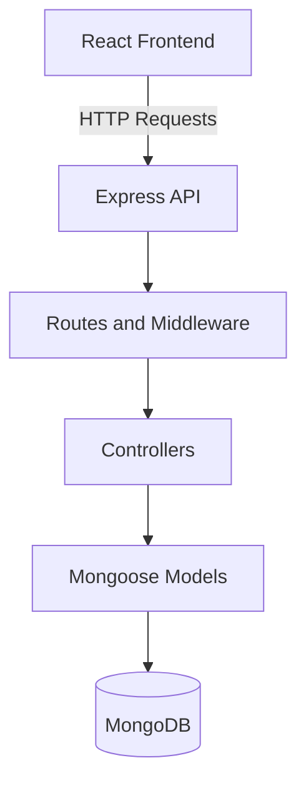
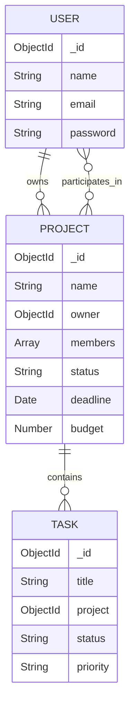

# Opsentra Business OS

## Software Design Document (SDD)

**Version:** 0.1

**Status:** Draft

**Project:** Opsentra Business OS

### 1. Introduction

#### 1.1 Purpose

This document describes the software architecture and technical design of Opsentra Business OS.

It explains how the frontend, backend, and database work together to implement the requirements defined in `docs/SRS.md`.

#### 1.2 System Overview

Opsentra Business OS is a web-based application for project management, task tracking, dashboard reporting, and team collaboration.

The application uses React for its user interface, Node.js and Express for backend services, and MongoDB for data persistence.

#### 1.3 Architectural Approach

Opsentra follows a three-tier logical architecture:

- **Presentation Layer:** React frontend handles user interfaces, navigation, and client-side interactions.
- **Application Layer:** Express backend handles API requests, business logic, authentication, and authorization.
- **Data Layer:** MongoDB and Mongoose handle application data storage and retrieval.

The backend is organized as a modular monolith, with responsibilities separated across routes, controllers, middleware, models, and validation modules.

#### 1.4 Design Objectives

- Maintain clear separation of responsibilities.
- Enforce secure authentication and authorization.
- Support maintainable and testable code.
- Provide reliable data access and validation.
- Allow future improvements to deployment, monitoring, and scalability.

#### 1.5 Related Documents

- `docs/SRS.md` — Software Requirements Specification.

### 2. System Architecture

#### 2.1 High-Level Architecture

Opsentra follows a three-tier architecture consisting of
a React frontend, an Express backend, and MongoDB.

The backend is organized as a modular monolith.
API routes, middleware, controllers, and Mongoose models
have separate responsibilities.

#### 2.2 Request Flow

1. The React frontend sends an HTTP API request.
2. Express routes direct the request through middleware.
3. Middleware handles authentication, authorization,
   and validation where required.
4. Controllers execute application business logic.
5. Mongoose models interact with MongoDB.
6. The backend sends an HTTP response to the frontend.

### 3. Frontend Architecture

#### 3.1 Overview

Opsentra uses React with Vite and Tailwind CSS.

The frontend follows a component-based architecture.
React Router manages navigation, while React Context
providers manage shared application state.

#### 3.2 Main Components

- `main.jsx` initializes the application and providers.
- `App.jsx` defines public and protected routes.
- `AuthProvider.jsx` manages authentication state.
- `ProjectsProvider.jsx` manages project data,
  pagination, search, filtering, and sorting.
- `NotificationProvider.jsx` manages notifications.
- `ProtectedRoute.jsx` restricts frontend navigation
  for unauthenticated users.
- `AppLayout.jsx` provides the application layout.

#### 3.3 Application Routing

Public routes:

- `/login`
- `/register`

Protected routes:

- `/dashboard`
- `/projects`
- `/projects/new`
- `/projects/:projectId`
- `/projects/:projectId/edit`

#### 3.4 State Management

React Context is used to share authentication,
project, and notification state.

Authentication and project providers communicate
with the Express API using HTTP requests.

Authentication cookies are included in relevant
API requests using `credentials: "include"`.

#### 3.5 Security Boundary

Frontend route protection improves navigation
and user experience.

Authentication and authorization decisions
must be enforced by the backend API.

### 4. Backend Architecture

#### 4.1 Overview

Opsentra uses Node.js and Express.js for its backend.

The backend follows a modular monolith architecture,
with separate modules for routing, middleware,
business logic, validation, and data access.

#### 4.2 Application Initialization

- `server.js` loads environment configuration,
  connects to MongoDB, and starts the HTTP server.
- `app.js` configures Express middleware,
  registers API routes, and handles errors.

#### 4.3 API Routes

The backend exposes the following route groups:

- `/api/auth` - User authentication
- `/api/projects` - Project, task, and membership operations
- `/api/dashboard` - Dashboard statistics
- `/api/health` - Application health
- `/api/ready` - Database readiness

#### 4.4 Middleware

Middleware handles cross-cutting concerns:

- JWT authentication
- Project-level authorization
- Request and query validation
- CORS and security headers
- Cookie parsing
- HTTP request logging
- Error handling

#### 4.5 Controllers

Controllers implement application business logic.

Current controller modules include:

- `authController.js`
- `projectController.js`
- `taskController.js`
- `projectMemberController.js`
- `dashboardController.js`

#### 4.6 Data Access

Mongoose models define database schemas and
support MongoDB operations.

The main models are:

- User
- Project
- Task

Project membership is stored within the
Project document.

#### 4.7 Security and Validation

Protected API routes verify JWT authentication.

Project-level middleware enforces Owner,
Editor, and Viewer permissions.

Zod validates supported request payloads
and query parameters.

Passwords are hashed using bcrypt.

#### 4.8 Logging and Error Handling

The backend uses Pino for structured logging.

Configured log redaction protects selected
authentication-related headers.

Centralized middleware handles unknown routes
and application errors.

#### 4.9 Architecture Constraints

The current backend is a modular monolith,
not a microservices-based system.

Future scaling or service decomposition
should be evaluated using actual application
requirements and performance evidence.

### 5. Database Design

#### 5.1 Overview

Opsentra uses MongoDB for persistent data storage
and Mongoose for schema definitions, validation,
and database operations.

The current application contains three primary
Mongoose models: User, Project, and Task.

#### 5.2 User Model

File: `backend/models/User.js`

Fields:

- name: String, required
- email: String, required, unique
- password: String, required, stored as a bcrypt hash
- createdAt: Date
- updatedAt: Date

User passwords are hashed before saving through
the Mongoose pre-save middleware.

#### 5.3 Project Model

File: `backend/models/Project.js`

Fields:

- name: String, required
- client: String, required
- status: Planning, In Progress, On Hold, Completed
- priority: Low, Medium, High
- deadline: Date, required
- budget: Number, required
- progress: Number, between 0 and 100
- description: String
- owner: ObjectId reference to User, required
- members: Embedded array of user references and roles
- createdAt: Date
- updatedAt: Date

Project membership supports Editor and Viewer roles.
The project owner is identified separately
through the owner field.

#### 5.4 Task Model

File: `backend/models/Task.js`

Fields:

- title: String, required
- description: String
- project: ObjectId reference to Project, required
- status: To Do, In Progress, Completed
- priority: Low, Medium, High
- dueDate: Date, optional
- createdAt: Date
- updatedAt: Date

#### 5.5 Database Relationships

- One User can own multiple Projects.
- Each Project has one owner.
- One Project can contain multiple Tasks.
- Each Task references one Project.
- Users can participate in multiple Projects
  through embedded project membership records.
- Each membership record stores a User reference
  and an Editor or Viewer role.

#### 5.6 Entity Relationship Diagram

The diagram represents logical relationships.
Project membership is stored in an embedded array,
not in a separate collection.

#### 5.7 Data Integrity

Mongoose schemas validate supported field values.

ObjectId references connect Users, Projects,
and Tasks at the application level.

The project deletion controller explicitly
removes associated tasks.

MongoDB does not automatically enforce relational
foreign-key constraints for these references.

### 6. Authentication and Authorization Design

#### 6.1 Overview

Opsentra uses JWT-based authentication and
project-level role-based access control (RBAC).

Authentication verifies user identity.
Authorization determines which project operations
the authenticated user can perform.

#### 6.2 User Registration

- Registration requests are validated using Zod.
- Duplicate email addresses are rejected.
- Passwords are hashed using bcrypt before storage.
- Successful registration returns user information.
- Users authenticate separately through login.

#### 6.3 Login and JWT Authentication

1. The user submits email and password.
2. The backend retrieves the user from MongoDB.
3. bcrypt compares the submitted password
   with the stored password hash.
4. The backend generates a signed JWT containing
   the user identifier.
5. The JWT is sent in an HTTP-only cookie.
6. Subsequent authenticated API requests include
   the cookie.

JWT expiration: 7 days.

Cookie configuration:

- HTTP-only: Enabled
- Secure: Enabled in production
- SameSite: None in production, Lax otherwise
- Cookie lifetime: 7 days

Registration and login endpoints use rate limiting.

#### 6.4 Authentication Middleware

File: `backend/middleware/authMiddleware.js`

The middleware:

- Reads the JWT from the token cookie.
- Verifies the token signature and expiration.
- Attaches the decoded user ID to `req.user`.
- Returns HTTP 401 for missing, invalid,
  or expired tokens.

#### 6.5 Role-Based Authorization

File: `backend/middleware/requireProjectAccess.js`

Project roles:

- Owner: Manage the project, tasks, and membership.
- Editor: View shared projects and manage their tasks.
- Viewer: Read shared projects and tasks.

Project updates, deletion, and membership
management are restricted to the Owner.

Task creation, updating, and deletion are
available to the Owner and Editor.

Task retrieval is available to all three roles.

Access to projects without membership or ownership
is denied.

#### 6.6 Logout

The logout endpoint clears the authentication
cookie from the browser.

The current implementation does not maintain
a server-side JWT revocation list.

A previously issued JWT remains valid until
expiration unless additional revocation
mechanisms are introduced.

#### 6.7 Verification

Related tests:

- `backend/tests/auth.test.js`
- `backend/tests/project.test.js`
- `backend/tests/projectMember.test.js`
- `backend/tests/task.test.js`

The local backend test suite passed:
51 tests passed, 0 failed.

Further security testing remains necessary,
including CSRF assessment, token expiration
edge cases, and comprehensive security review.

### 7. Deployment Architecture

#### 7.1 Overview

Opsentra uses a separated frontend and backend
architecture with MongoDB for persistent storage.

The repository documents Render deployments
for the frontend and backend.

The database connection is configured through
the MONGO_URI environment variable.

#### 7.2 Deployment Components

Frontend:

- React application built using Vite.
- Communicates with the backend through HTTP APIs.
- Uses VITE_API_URL for backend configuration.

Backend:

- Node.js and Express application.
- Connects to MongoDB using Mongoose.
- Uses environment variables for configuration.
- Exposes health and readiness endpoints.

Database:

- MongoDB stores Users, Projects, and Tasks.
- Connection details are not hardcoded.

#### 7.3 Containerization

The repository includes `backend/Dockerfile`.

The Dockerfile:

- Uses the node:24-alpine base image.
- Sets /app as the working directory.
- Installs production dependencies using npm ci.
- Copies the backend application files.
- Exposes port 5001.
- Starts the application using npm start.

The repository also includes a .dockerignore
file to exclude unnecessary and sensitive files.

The Dockerfile supports backend containerization.
Production Docker deployment is not yet verified.

#### 7.4 Continuous Integration

File: `.github/workflows/ci.yml`

GitHub Actions runs on pushes and pull requests.

Frontend checks:

- Dependency installation
- Automated tests
- ESLint validation
- Production build

Backend checks:

- Dependency installation
- Syntax validation
- Automated integration tests
- MongoDB test service

The CI workflow uses Node.js 24 and MongoDB 8.

#### 7.5 Continuous Deployment

The README documents frontend and backend
deployments on Render.

The repository's verified GitHub Actions
workflow performs CI checks.

Automated production deployment configuration,
deployment triggers, and rollback behavior
require separate verification.

#### 7.6 Runtime Configuration

Backend environment variables include:

- MONGO_URI
- JWT_SECRET
- CLIENT_URL
- PORT
- NODE_ENV

Frontend environment variables include:

- VITE_API_URL

Secrets must not be committed to version control.

#### 7.7 Health and Readiness

GET /api/health:

- Returns HTTP 200 when the API is running.

GET /api/ready:

- Returns HTTP 200 when MongoDB is connected.
- Returns HTTP 503 when MongoDB is disconnected.

These endpoints are covered by backend tests.

#### 7.8 Future Deployment Improvements

Planned engineering improvements include:

- Verify and document production deployment settings.
- Evaluate Docker-based production deployment.
- Establish a documented rollback strategy.
- Add production monitoring and alerting.
- Perform performance and load testing.
- Evaluate container orchestration only when needed.

These improvements are future considerations,
not confirmed production capabilities.
